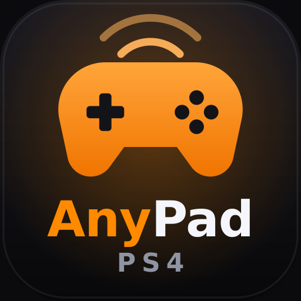

<p align="center"></p>

# AnyPad PS5：PS5 を DualSense から解放しよう

**ジェイルブレイク済み PS5 向けの Bluetooth コントローラーブリッジ。**

[English · Español](README.md) · [Français](README.fr.md) · [Italiano](README.it.md) · [Português](README.pt.md) · [Deutsch](README.de.md) · [Русский](README.ru.md) · [简体中文](README.zh.md) · [繁體中文](README.zh-Hant.md) · **日本語** · [한국어](README.ko.md) · [العربية](README.ar.md)

---

AnyPad PS5 を使うと、ほかのプラットフォームのコントローラーを PS5 で使えます。本体の Bluetooth チップを通じてコントローラーを接続し、仮想の DualSense コントローラーとしてシステムに見せます。

USB アダプターは不要です。

**バージョン 0.9.5-beta。** PS5 fat、ファームウェア 10.01 で、DualShock 4 と 8BitDo SF30 Pro（Switch モード）を使い、本体メニュー、ゲーム、エミュレーターで動作確認しています。

**12 言語に対応：** 英語、スペイン語、フランス語、イタリア語、ポルトガル語、ドイツ語、ロシア語、簡体字中国語、繁体字中国語、日本語、韓国語、アラビア語。AnyPad のページは本体の言語に従います。

---

## このプロジェクトについて

AnyPad PS5 は、最初のバージョンを公開した 2026 年 10 月 3 日の 14:20 ごろ（スペイン時間）に始まりました。きっかけは MissionControl で、Nintendo Switch で他の本体のコントローラーを使えるようにするものです。AnyPad は PS5 で他のコントローラーを使えるようにした最初のプロジェクトではないかもしれません。USB で接続するプロジェクトはすでにありました。しかし Bluetooth で接続するものはなく、AnyPad が最初でした。アイデアを思いつき、それを形にしました。

いまの目標は、AnyPad をより多くのコントローラーで動くようにすることです。試していただいたら、ログを送ってください（下の「互換性の確認にご協力ください」を参照）。どのログも役に立ちます。

ソースコードの全体は、このリポジトリで GPL-3.0-or-later のもとに公開されています（下の「オープンソースと AI との協働」を参照）。エミュレーターを開発していて AnyPad を組み込みたい方は、そのライセンスのもとで可能です。ご不明な点は [exposed.ct.ws@gmail.com](mailto:exposed.ct.ws@gmail.com) までご連絡ください。

既知の問題が 1 つ残っています。AnyPad の実行中に DualSense の電源を切ると、青く点滅したままになることがあります。今後のプロジェクトにはこの問題がないことを願います。私が公開したコードから作られた AnyPad のフォークは、ほぼ間違いなくこの問題を引き継ぎます。これは AnyPad の遺産であり、少なくとも Bluetooth の部分では AnyPad のフォークであることの印です。

---

## オープンソースと AI との協働

バージョン 0.9.5 から、AnyPad PS5 のソースコードをすべてこのリポジトリで公開しています（GPL-3.0-or-later）。Bluetooth ホスト、コントローラーのプロファイル、AnyPad のページ、テスト、ビルド用スクリプトが含まれます。シミュレーターも入っているので、本体がなくてもコンピューターでコントローラーを確認できます。

AnyPad が本当に加えたものは、ブリッジそのものよりも、**AI の助けを借りて新しいコントローラーを組み込むための通信の仕組み**だと考えています。AnyPad の実行中、そのページはローカルネットワーク上で次のものを提供します。

- リアルタイムのログ。
- 再起動も再ビルドもせずに、動作中に変更できる Bluetooth 接続の設定がいくつか。
- ペアリングのボタン。

同じネットワーク上のコンピューターでターミナルを使える AI アシスタント（たとえば Claude Code、Codex CLI、Gemini CLI）は、コントローラーの電源を入れている間の AnyPad の動きを追い、変更を提案し、ELF をビルドし直して本体に送り、次の実行で結果を確認できます。AnyPad 自体もこの方法で改良されてきました。

ファイル **[AI-WORKFLOW.md](AI-WORKFLOW.md)**（英語）は、そのアシスタント向けのガイドです。接続の仕方、触ってよいものといけないもの、変更のテスト方法、新しいコントローラーの追加方法が書かれています。最初の指示としてアシスタントに渡せます。

ご注意ください。

- ブラウザー上のチャットでは本体に届きません。アシスタントには、PS5 と同じローカルネットワークにつながったコンピューターのターミナルが必要です。AnyPad 自体はインターネットに接続しません。
- どのバージョンでも同じく、ページに PIN はありません。ローカルネットワークにいる誰でもログを読み、AnyPad にコマンドを送れます。信頼できるネットワークでのみ使い、終わったら AnyPad を停止してください。
- ログには、コントローラーの Bluetooth アドレスと本体のユーザー ID が含まれます。共有する前に確認してください。

### あなた（と AI）が学んだことを共有してください

AI を使うかどうかにかかわらず、AnyPad をあるコントローラーに合わせた場合は、[issue](https://codeberg.org/elmonomalva0/Any-Pad-ps5/issues) を作成し、コントローラーのモデル、本体のファームウェア、脱獄の方法、AnyPad のバージョン、変更した内容とその理由、そしてログを書いてください。AI が手伝った場合はそのことを書き、説明は AI に書かせてください。コントローラーの何が違うのか、何を変えたのか、どうテストしたのか、です。提案はすべて確認し、互換性のあるものは今後のバージョンに取り入れます。変更は `make test` に合格し続けること、そして DualShock 4 と 8BitDo の接続のしかたを変えないことが条件です。

### ソースからビルドする

[ps5-payload-sdk](https://github.com/ps5-payload-dev/sdk) が必要です。

```
make test                                               # コンピューター上のテスト（Bluetooth シミュレーター使用）
make ps5 PS5_PAYLOAD_SDK=/path/to/ps5-payload-sdk       # dist/ に ELF を作る
tools/build-elf-docker.sh /path/to/ps5-payload-sdk      # または同じことをコンテナー内で
```

### 私の名前を載せてください

AnyPad の独自バージョンを作ったり、AnyPad（またはその一部）をエミュレーター、HEN、payload、その他のプログラムに組み込んだりする場合は、**elmonomalvad0** の名前を挙げ、このプロジェクトへのリンクを載せていただけるととてもうれしいです。GPL-3.0-or-later のライセンスは、著作権表示を残すことと、変更を同じライセンスで配布することをすでに求めています。名前を載せることはお願いであって条件ではありませんが、それがこの活動を共有し続ける励みになります。

### コードの構成

| 場所 | 役割 |
| --- | --- |
| `src/host.c` | Bluetooth Classic ホスト：検索、呼び出し、ペアリング、L2CAP チャンネル、SDP、HID |
| `src/le.c` | Bluetooth LE：スキャン、Secure Connections によるペアリングと ID の交換、GATT 上の HID |
| `src/profiles.c` | コントローラーのファミリーごとに 1 つのプロファイル：ID、レポートの読み方、起こすための手順、振動とライト |
| `src/generic.c`, `maps/` | それ以外の HID コントローラー。自身のディスクリプターと任意のマッピングファイルで読み取ります |
| `src/hci_usb.c`, `src/usb_desc.c`, `src/evstream.c` | 本体の Bluetooth チップ（システムと共有）との USB 経由の HCI |
| `src/ps5_vpad.c` | 仮想 DualSense を作り、データを送ります |
| `src/web.c`, `web/index.html` | ページとその API |
| `src/ps5_main.c` | payload のメインループ |
| `tests/` | Bluetooth シミュレーター（`sim.c`、`sim_le.c`）とすべてのテスト |

コントローラーを追加するのは、たいていの場合、`src/profiles.c` にプロファイルを 1 つ足し、シミュレーターでテストを書くことです。詳しくは [AI-WORKFLOW.md](AI-WORKFLOW.md) をご覧ください。

---

## 0.9.5 の新機能

- **オープンソース：** コードをすべて公開し、AI アシスタントと協働するためのガイドを付けました。

## 0.9 の新機能

- **互換性の向上：** 対応コントローラーが増え、PS5 に使われている 2 種類の Bluetooth チップの両方に対応しました。
- **不具合の修正。**
- AnyPad ページの**新しいグラフィカルインターフェース**。

## 0.8 の新機能

### より速いペアリング

ペアリングがずっと速く、確実になりました。私たちのテストでは、DualShock 4 と 8BitDo は数秒で見つかり、その数秒後には使える状態になります。以前は何度も試す必要がありました。

### より安定

- **なめらかな反応：** プレイ中もコントローラーが遅延なく反応します。
- **ペアリングモードではなく通常どおり電源を入れたコントローラー**も、1 回目でペアリングできます。
- **反応が遅い、または手順を拒否するコントローラー**への対応が賢くなりました。

### PS を設定

使える PS ボタンがないコントローラー（Switch Pro、8BitDo など）では、**PS を設定**ボタンで、PS ボタンの代わりになる**ボタン 1 個または 3 個の組み合わせ**を選べます。個数を選び、コントローラーでそのボタンを押して 1 秒間押し続けると、AnyPad が自動で検出します。設定はそのコントローラーのモデルごとに保存されます。

DualShock 4 と DualSense には専用の PS ボタンがあるため、この項目は表示されません。

### 12 言語

AnyPad のページは本体の言語に従います。英語、スペイン語、フランス語、イタリア語、ポルトガル語、ドイツ語、ロシア語、簡体字中国語、繁体字中国語、日本語、韓国語、アラビア語（右から左）。それ以外の言語は英語になります。

---

## ⚠️ 重要：AnyPad の実行中は DualSense の電源を切らないでください

AnyPad の実行中に DualSense の電源を切ると、青く点滅するモードになり、本体を再起動するまで使えなくなることがあります。

しばらく操作しないと本体が自動で電源を切ってしまうのを防ぐには、次のように設定してください。

**設定 → システム → 省電力 → コントローラーの電源を切るまでの時間を設定 → 切らない**

電源を切らなければ、すべて通常どおり動作します。

---

## ⚠️ 重要：外部コントローラーには「クイックプレイ / ゲスト」を選んでください

外部コントローラーで PS ボタンを押すと、本体が誰が使うかを尋ねます。**クイックプレイ / ゲスト**を選んでください。メインユーザーは DualSense を使い続け、DualSense を手に取ればいつでも戻れます。

---

# コントローラーの互換性

| コントローラー | 状態 | 備考 |
| --- | --- | --- |
| **DualShock 4** | ✅ **動作確認済み** | ペアリングのたびにペアリングモード（Share + PS）にしてください。 |
| **8BitDo SF30 Pro（Switch モード）** | ✅ **動作確認済み** | Switch Pro Controller として認識されます。PS ボタンには「PS を設定」を使ってください。 |
| **GameSir G7 SE** | ✅ **動作確認済み** | |
| **Nintendo Switch Pro Controller** | 🧪 **対応済み、未テスト** | Switch モードの 8BitDo と同じプロトコルです。 |
| **Xbox コントローラー** | ✅ **動作（ユーザー報告）** | 0.8 以降で動作するとユーザーから報告があります。接続できない場合は、ログとモデル名を送ってください。 |
| **その他の Bluetooth HID ゲームパッド** | 🧪 **汎用プロファイル** | 専用プロファイルがなくても動く場合があります。 |

**互換性があると考えているコントローラー**（コードでは対応済み、実機では未テスト）：DualShock 4 v1、Hori Onyx、Razer Raiju Ultimate、Razer Raiju Tournament Edition、SCUF Vantage 2、Nintendo Switch Pro Controller、Nintendo Switch Online（SNES、N64、Mega Drive / Genesis）、GameSir G3s・G4s・G7 Pro・T1s・T2a、Betop 2585N2、Bionik Vulkan、LanShen X1Pro、Xiaomi Mi Controller、Amazon Fire / iPega、iPega 9-series、8BitDo SN30 Pro（Xbox Cloud Gaming 版）、8BitDo Ultimate 2.4G、SteelSeries、NVIDIA Shield コントローラー（2017）、Razer Serval、PowerA MOGA Hero・MOGA Pro・MOGA Pro 2、Atari VCS Modern コントローラー、Hyperkin Scout、Mocute 050。試した場合は、ログを送ってください。

機種ごとの完全な一覧は [COMPATIBILITY.md](COMPATIBILITY.md) にあります。

---

# 仕組み

AnyPad PS5 は、ジェイルブレイク済み PS5 上で常駐 payload として動作します。本体の Bluetooth チップを**システムと共有**して、コントローラーを探してペアリングし、入力を読み取り、仮想の DualSense として PS5 に見せます。

ゲーム、PS5 のファームウェア、ジェイルブレイク自体は**変更しません**。PS5 が payload を実行できる状態であることが前提です。

---

# 使い方

1. **AnyPad を読み込む。** [Releases](https://codeberg.org/elmonomalva0/Any-Pad-ps5/releases) から `AnyPad-PS5-0.9.5-beta.elf` をダウンロードし、いつも使っている payload ローダーで読み込みます。
2. **ページを開く。** 本体の「メディア」の行で **AnyPad** を開くか、同じネットワークのスマートフォンやパソコンで `http://<本体のIP>:8095` を開きます。
3. **ペアリング。** **ペアリング**を押し、本体の近くでコントローラーをペアリングモードにします。

| コントローラー | ペアリングモード |
| --- | --- |
| **DualShock 4** | ライトバーが 2 回点滅するまで **Share + PS** を押し続ける |
| **8BitDo（Switch モード）** | ランプが速く点滅するまで **Pair** を約 3 秒押し続ける |
| **Nintendo Switch Pro** | USB-C ポートの横にある小さな同期ボタンを押す |
| **その他のコントローラー** | メーカーの説明に従う |

4. **ユーザーを選ぶ。** 本体に尋ねられたら、**クイックプレイ / ゲスト**を選びます。

DualSense と一緒に、複数のコントローラーを同時に使えます。

---

# 毎回まっさらな状態で開始

AnyPad は、実行をまたいでペアリング済みのコントローラーを保存しません。AnyPad を起動するたびにコントローラーをペアリングしてください。これにより、使えなくなった古いペアリングを避け、Bluetooth チップを把握できる状態に保てます。

電源を切ったコントローラーが勝手に再接続して反応しない場合は、いったん電源を切り、ページから再度ペアリングしてください。

---

# AnyPad を停止する

必ずページの **AnyPad PS5 を停止**で止めてください。再度実行する前、および本体の電源を切る前や再起動する前も同様です。**終了**ボタンはページを閉じるだけです。

---

# トラブルシューティング

### コントローラーが見つからない

1. 先に**ペアリング**を押し、そのあとでコントローラーをペアリングモードにしてください。
2. コントローラーが本当にペアリングモードになっているか確認してください（たとえば DualShock 4 のライトバーが 2 回点滅するはずです）。
3. 以前ほかの機器とペアリングしたコントローラーがまだ表示されない場合は、リセットしてやり直してください（DualShock 4：L2 の横の小さな穴にクリップを入れて約 5 秒、8BitDo Pro 2：Pair を約 5 秒押し続ける）。

### 別のコントローラー用 payload が動いている

Bluetooth チップとポート 8095 を使う別の payload があると干渉します。AnyPad を実行する前に、その payload のメニューから停止してください。AnyPad はこれを検出すると画面に通知します。

### ページが開かない

AnyPad が動いていること、スマートフォンやパソコンが PS5 と同じネットワークにあること、本体の IP アドレスにポート `8095` を付けていることを確認してください。

---

# 互換性の確認にご協力ください

AnyPad PS5 があるコントローラーで動作する（または動作しない）ことを確認できたら、ログ（`/data/anypad/anypad.log`）を [exposed.ct.ws@gmail.com](mailto:exposed.ct.ws@gmail.com) に送ってください。コントローラーのモデル、本体のファームウェア、ジェイルブレイク、AnyPad のバージョンも添えてください。とても助かります。

### プロジェクトを支援する

ほかのコントローラーや本体のバージョンを試してほしいという声を多くいただきます。**このプロジェクトを PS4 と PS5 ファームウェア 13.60 に移植**したり、**より多くのコントローラーに対応**したりするための協力を歓迎します。10.01 の本体に加えて、13.60 の本体も持てたら嬉しいです。必須ではありませんが、プロジェクトを助けたい方は Throne のページからお願いします：**[throne.com/elmonomalvad0](https://throne.com/elmonomalvad0)**

---

# クレジット

AnyPad PS5 は独自のコードです。仕組みを理解するために次のプロジェクトを調べ、そのアイデアを AnyPad のために書き直しました。作者の皆さんに感謝します。

- **[FGG-PlayPods](https://github.com/FGGstore/FGG-PlayPods)**（FGGstore）：Bluetooth 部分の発想、つまり PS5 の Bluetooth チップをシステムと共有すること。
- **[MissionControl](https://github.com/ndeadly/MissionControl)**（ndeadly）：メーカー・モデル別のコントローラープロファイルと、多くのコントローラーのレポート形式。
- **Ghostcontrol**（StonedModder）：PS5 で仮想 DualSense を作成してユーザーに割り当てる方法。
- **[SplashDown](https://github.com/seregonwar/SplashDown)**（seregonwar）と **[shadPS4](https://github.com/shadps4-emu/shadPS4)**：仮想コントローラーの手順とコントローラーのデータ形式。
- **[HearBridge-PS5](https://github.com/X-F1REBALL-X/HearBridge-PS5)**（X-F1REBALL-X）：Bluetooth のネゴシエーションに関するアイデア。
- **[ps5-payload-sdk](https://github.com/ps5-payload-dev/sdk)**（John Törnblom）：すべてのビルドに使っているツールチェーン。

ライセンス：GPL-3.0-or-later（[LICENSE](LICENSE)）。

作者：**elmonomalvad0**、GitHub のオリジナル AnyPad PS5 を作った *sinfiltros* と同じ作者です。
X：[@elmonomalvad0](https://x.com/elmonomalvad0) · 連絡先：exposed.ct.ws@gmail.com
